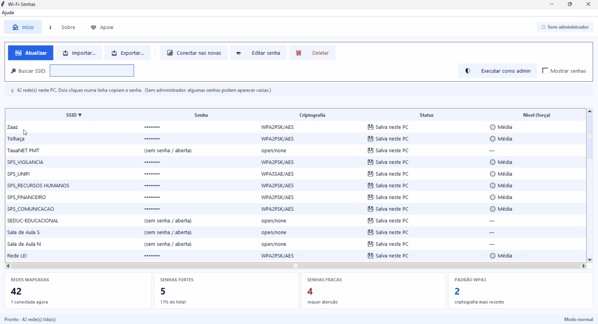

# Wi-Fi Senhas

**Visualize, gerencie e organize as redes Wi-Fi salvas no seu computador.**

O **Wi-Fi Senhas** é um aplicativo desenvolvido em Python que permite visualizar e gerenciar as redes Wi-Fi salvas no computador, incluindo as respectivas senhas.

Com uma interface gráfica simples e intuitiva, oferece recursos para listar, importar, exportar, conectar, editar e excluir redes Wi-Fi.


## Demonstração

Conheça as principais funcionalidades do Wi-Fi Senhas

| Wi-Fi Senhas                                               | 
| ---------------------------------------------------------- |
|  |


## Funcionalidades

- **Listar redes Wi-Fi:** exibe as redes salvas no computador com SSID, senha, tipo de criptografia, status e nível de força da senha.
- **Identificar status:** informa se a rede está conectada agora, salva no computador ou apenas importada.
- **Nível de força:** estimativa visual da senha (🔴 fraca, 🟡 média, 🟢 forte), calculada a partir do tamanho e da variedade de caracteres. Serve só como referência.
- **Buscar e ordenar:** filtro por SSID e ordenação por qualquer coluna, com linhas zebradas.
- **Conectar às novas redes:** cria o perfil e conecta apenas nas redes importadas que ainda não existem no computador, com barra de progresso.
- **Editar senhas:** altera a senha de uma rede salva.
- **Excluir redes:** remove redes Wi-Fi armazenadas no computador.
- **Exportar listas:** salva as redes em **CSV**, **JSON** ou **TXT**, para backup ou transferência.
- **Importar listas:** carrega listas exportadas anteriormente (CSV, JSON ou TXT).
- **Copiar senha:** dois cliques em uma linha copiam a senha para a área de transferência.
- **Resumo:** cartões com o total de redes, senhas fortes, senhas fracas e redes WPA3.

## Compatibilidade

| Sistema operacional | Listar redes | Importar / Exportar | Conectar | Editar / Excluir |
| ------------------- | :----------: | :-----------------: | :------: | :--------------: |
| Windows 10/11       |      ✅      |         ✅          |    ✅    |        ✅        |
| Linux               |      ✅      |         ✅          |    ❌    |        ❌        |
| macOS               |      ✅      |         ✅          |    ❌    |        ❌        |

**Observação:** as funcionalidades de conexão, edição e exclusão estão implementadas somente para Windows. No Linux e no macOS estão disponíveis apenas a listagem, a importação e a exportação de redes.

## Requisitos

- Python 3.8 ou superior.
- Tkinter (normalmente incluído na instalação do Python).
- Windows 10/11 para utilizar todas as funcionalidades.

Não é necessário instalar bibliotecas adicionais, desde que o Tkinter esteja disponível.

> No Linux, o Tkinter pode ser um pacote separado (por exemplo, `sudo apt install python3-tk`) e a listagem usa o `nmcli` (NetworkManager).

## Instalação e execução

**1. Clone o repositório:**

```bash
git clone https://github.com/IvandeCoelho/Wi-Fi-Senhas.git
```

**2. Acesse a pasta do projeto:**

```bash
cd Wi-Fi-Senhas
```

**3. Execute o aplicativo:**

```bash
python wifi_senhas.py
```

## Permissões (administrador)

No Windows, algumas senhas só aparecem, e as ações de conectar, editar e excluir só funcionam de forma confiável, quando o aplicativo roda como administrador. Se ele for aberto sem essa permissão, use o botão **Executar como admin** na tela inicial (o Windows pede a sua confirmação). No Linux pode ser necessário `sudo`, e no macOS o sistema pede a senha de administrador para cada rede lida.

## Formatos de importação e exportação

| Formato | Conteúdo                                              |
| ------- | ----------------------------------------------------- |
| CSV     | colunas `Rede`, `Senha`, `Criptografia` (abre no Excel) |
| JSON    | lista de objetos com `rede`, `senha` e `criptografia`  |
| TXT     | blocos `Rede:`, `Senha:` e `Criptografia:`             |

## Limitações conhecidas

- Conectar, editar e excluir funcionam apenas no Windows.
- Ao **conectar** a uma rede importada ou **editar** uma senha, o perfil é recriado assumindo **WPA2-PSK/AES** (ou rede aberta, se a senha estiver vazia). Redes com outro tipo de segurança, como WPA3 ou corporativas, podem não conectar.
- A conexão só funciona com redes que estejam ao alcance no momento, e o Windows mantém uma rede Wi-Fi por vez. A conexão atual pode cair durante o processo.
- O nível de força da senha é uma estimativa simples, não uma auditoria de segurança.

## Segurança e privacidade

O aplicativo permite visualizar informações de autenticação das redes Wi-Fi armazenadas no computador. Ele funciona 100% localmente, usa apenas utilitários do próprio sistema e **não envia nenhuma senha ou dado de rede para a internet**.

**Utilize exclusivamente no seu próprio computador ou em equipamentos para os quais você tenha autorização.**

- Não utilize o aplicativo para acessar redes sem autorização.
- Os arquivos exportados contêm senhas em texto puro: mantenha-os em local seguro e apague quando não precisar mais.
- Evite compartilhar arquivos que contenham senhas de redes Wi-Fi.
- Utilize as permissões necessárias para realizar as operações de gerenciamento.

## Tecnologias utilizadas

- **Python 3:** linguagem de programação.
- **Tkinter:** interface gráfica.
- **Recursos nativos do sistema operacional:** `netsh` (Windows), `nmcli` (Linux) e `security` (macOS) para ler e gerenciar as configurações de redes Wi-Fi.

## Contribuição

Contribuições são bem-vindas!

Caso encontre algum problema, tenha sugestões de melhorias ou queira contribuir com o desenvolvimento, fique à vontade para abrir uma [Issue](https://github.com/IvandeCoelho/Wi-Fi-Senhas/issues) ou enviar um Pull Request.

## Licença

Este projeto está licenciado sob a licença [MIT](LICENSE).

---

**Wi-Fi Senhas** — Suas redes Wi-Fi em um só lugar
